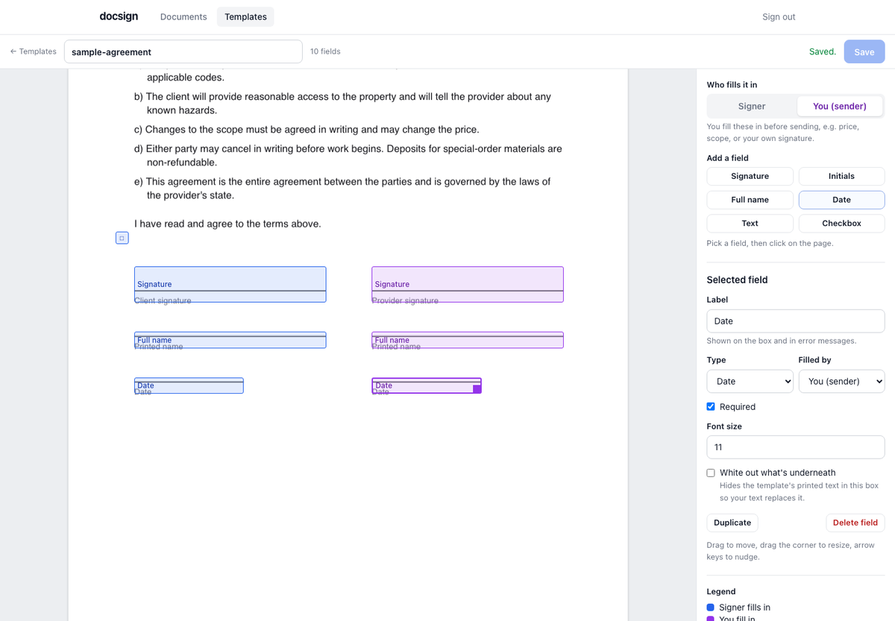
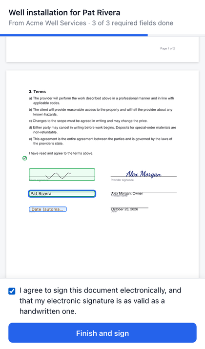
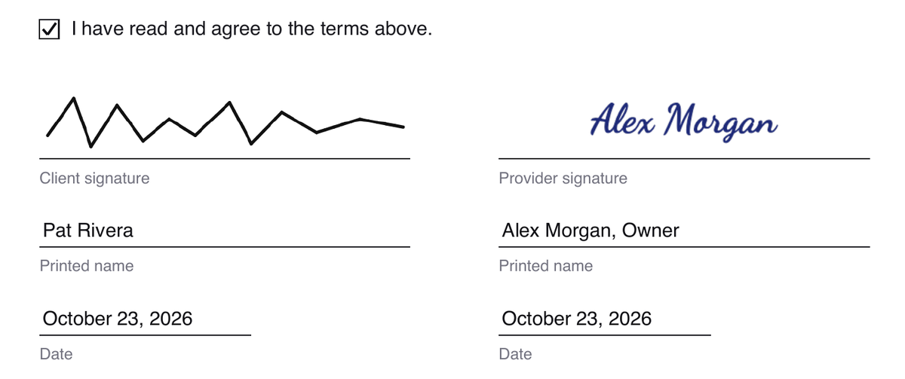
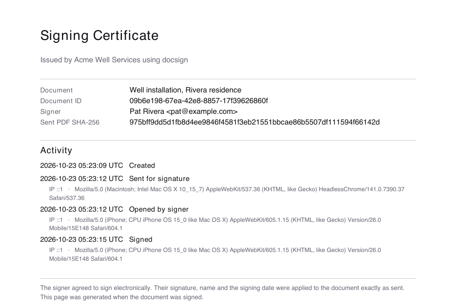
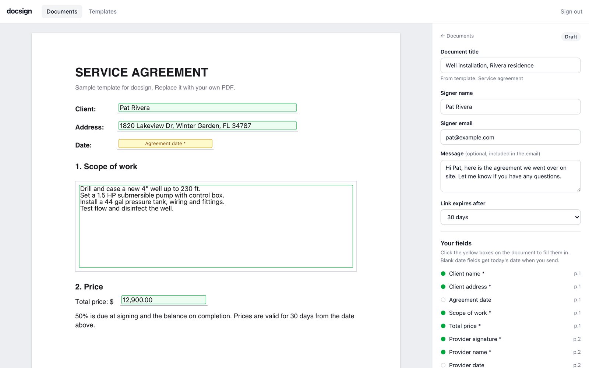
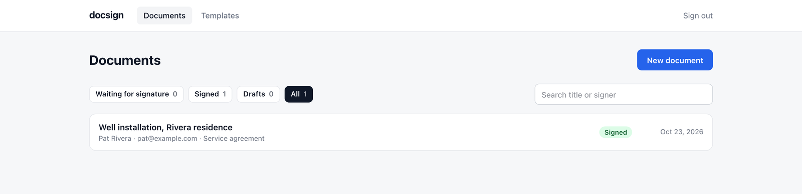

# docsign

**A free, self-hosted alternative to paid e-signature services.** Upload any PDF as a template, place signature and text fields on it, fill in your part, and send it to someone to sign from their phone or computer. You get back a flattened, signed PDF with a signing certificate.

You run it on your own server and your own database, so your documents stay with you. No per-envelope fees and no monthly seats.



## Features

- **Use your own PDFs.** Contracts, proposals, waivers, intake forms. Upload once, reuse forever.
- **Drag-and-drop field editor.** Signature, initials, full name, date, text (single or multi-line) and checkbox fields. Click to place, drag to move, drag the corner to resize, arrow keys to nudge.
- **Two parties per document.** Each field is filled by either *you* (the sender) or *the signer*. You fill in the price, scope or your own signature before sending; the signer does the rest.
- **Change the text on your templates.** Sender text fields can have default text that you edit per document. Turn on *white out* and the field hides whatever the PDF printed underneath, so your text replaces it.
- **Signing that works on phones.** No account needed. A "Next field" button walks the signer through every box; draw, type or upload a signature; it's reused for every other signature box.
- **Tamper-evident records.** The PDF is frozen when you send it. The signer's input is drawn onto that exact copy, and a signing certificate page is appended with timestamps, IP addresses, browsers and the SHA-256 fingerprint of the sent PDF.
- **Email optional.** Works with [Resend](https://resend.com) or any SMTP server. Without email, you get a signing link to send however you like (text message, WhatsApp, your own email).
- **Reminders, expiring links, voiding**, and a full activity log per document.
- **Bring your own database.** Any PostgreSQL works: [Neon](https://neon.tech), [Supabase](https://supabase.com), Railway, RDS, or the one in the included Docker setup. Tables are created automatically.

## Screenshots

<table>
  <tr>
    <td width="34%" valign="top"></td>
    <td width="66%" valign="top">
      
      <br><br>
      
    </td>
  </tr>
  <tr>
    <td valign="top"><sub><b>Signing on a phone.</b> No account, a guided "Next field" button, draw or type a signature.</sub></td>
    <td valign="top"><sub><b>The finished PDF.</b> Every value is drawn exactly on its line, then a signing certificate with the full audit trail is appended.</sub></td>
  </tr>
</table>


<sub><b>Preparing a document.</b> Fill in your fields right on the page, add the signer, and send.</sub>


<sub><b>Dashboard.</b> Track what's waiting for a signature, signed, or still a draft.</sub>

## Quick start

### Option 1: Deploy to Vercel (free tier works)

[](https://vercel.com/new/clone?repository-url=https%3A%2F%2Fgithub.com%2Faustinpark407%2Fdocsign&env=DATABASE_URL,ADMIN_PASSWORD,SESSION_SECRET,ORG_NAME&envDescription=DATABASE_URL%20is%20any%20PostgreSQL%20connection%20string.%20SESSION_SECRET%20is%20a%20random%2032%2B%20character%20string.&envLink=https%3A%2F%2Fgithub.com%2Faustinpark407%2Fdocsign%23configuration&project-name=docsign&repository-name=docsign)

1. Create a free PostgreSQL database, for example on [Neon](https://neon.tech) (or add Neon from the Vercel dashboard under **Storage**), and copy its connection string.
2. Click the button above and fill in the four variables. For `SESSION_SECRET`, run `openssl rand -hex 32` or use any password generator (32+ characters).
3. Open your new site, sign in with `ADMIN_PASSWORD`, and upload your first template.

Add email later by setting `RESEND_API_KEY` (or the `SMTP_*` variables) and `EMAIL_FROM` in your Vercel project settings.

### Option 2: Docker (any server or your own computer)

```bash
git clone https://github.com/austinpark407/docsign.git
cd docsign
cp .env.example .env      # set ADMIN_PASSWORD, SESSION_SECRET and APP_URL
docker compose up -d
```

Open http://localhost:3000. The compose file runs PostgreSQL alongside the app and keeps data in a Docker volume.

### Option 3: Run locally for development

Requires Node.js 20+ and a PostgreSQL database.

```bash
git clone https://github.com/austinpark407/docsign.git
cd docsign
npm install
cp .env.example .env.local   # fill in DATABASE_URL, ADMIN_PASSWORD, SESSION_SECRET
npm run dev
```

A sample template is included at [`examples/sample-agreement.pdf`](examples/sample-agreement.pdf) if you want something to try.

## How it works

1. **Templates.** Upload a PDF on the *Templates* page, then place fields. Blue fields are filled by the signer, purple ones by you. A template needs at least one signer field before it can be sent.
2. **Documents.** Click *New document* and pick a template. Enter the signer's name and email, then click the yellow boxes to fill in your fields. *Preview PDF* shows exactly what the signer will see.
3. **Send.** docsign renders your values into the PDF and freezes it. Nothing about that copy can change afterward, even if you edit the template. The signer gets an email (or you share the link).
4. **Sign.** The signer reviews the document, fills in their fields, agrees to sign electronically, and finishes. Date fields are stamped automatically.
5. **Done.** Both of you get the signed PDF (when email is set up), and it's always downloadable from the document page.

## Configuration

All settings are environment variables. See [`.env.example`](.env.example) for a commented template.

| Variable | Required | Description |
| --- | --- | --- |
| `DATABASE_URL` | Yes | PostgreSQL connection string. `POSTGRES_URL` also works. |
| `ADMIN_PASSWORD` | Yes | Password for the sender dashboard. |
| `SESSION_SECRET` | Yes | Random string, 32+ characters, used to sign login cookies. |
| `APP_URL` | Recommended | Public URL used in signing links. Defaults to your Vercel production domain. |
| `ORG_NAME` | Recommended | Your business name, shown to signers and in emails. |
| `APP_NAME` | No | Name in the header and browser tab. Default `docsign`. |
| `EMAIL_FROM` | For email | Sender address, e.g. `Acme <sign@acme.com>`. Must be a domain your email provider lets you send from. |
| `RESEND_API_KEY` | For email | Use Resend for delivery. |
| `SMTP_HOST`, `SMTP_PORT`, `SMTP_USER`, `SMTP_PASS`, `SMTP_SECURE` | For email | Use any SMTP server instead of Resend. |
| `NOTIFY_EMAIL` | No | Also email every signed document to this address. |
| `DEFAULT_EXPIRES_DAYS` | No | Days before a signing link expires. Default 30; `0` means never. |
| `TIMEZONE` | No | Fallback time zone for stamped dates. The signer's own time zone is used when their browser reports it. |
| `DATABASE_POOL_MAX` | No | Max database connections per server instance. Default 5. |

## Security

- The admin dashboard is protected by a single password with login rate limiting and signed, HTTP-only session cookies.
- Signing links use 256-bit random tokens, expire, stop working once a document is signed or voided, and are never sent in the `Referer` header.
- Pages can't be embedded in other sites (clickjacking protection), and state-changing requests are checked against the request origin.
- Uploaded signature images are size-limited and checked against their declared type. Templates are checked before they're stored.
- Signed PDFs are flattened: no editable form fields remain.

Found a vulnerability? Please open a private security advisory on GitHub rather than a public issue.

## Limitations

docsign is deliberately small. Today it does **not** have:

- multiple user accounts or teams (one admin password per installation),
- more than one signer per document, or signing order,
- templates with rotated pages (re-save the PDF with "Print to PDF" first),
- PDFs over 4 MB (a Vercel request limit),
- certificate-based (PKI) digital signatures.

Fonts on the PDF are the standard Helvetica set, which covers Western European characters. Characters it can't draw, like emoji, are left out.

## Legal note

Electronic signatures are legally recognized for most agreements in many countries, including under the U.S. ESIGN Act and UETA and the EU's eIDAS regulation. Some documents (for example wills, certain real estate or court filings) have extra requirements. docsign records consent, an audit trail and a fingerprint of the sent document, but whether that's enough for your use is a question for your lawyer. This project is provided as is, without warranty. It is not legal advice.

## Tech stack

[Next.js](https://nextjs.org) (App Router) · React · TypeScript · Tailwind CSS · [pdf-lib](https://pdf-lib.js.org) to write PDFs · [PDF.js](https://mozilla.github.io/pdf.js/) to display them · [postgres.js](https://github.com/porsager/postgres)

## Development

```bash
npm run dev          # start the dev server
npm test             # unit tests
TEST_DATABASE_URL=postgres://localhost:5432/docsign_test npm test   # include database tests (use a throwaway database)
npm run lint
```

Contributions are welcome. Please open an issue to discuss larger changes first.

## License

[MIT](LICENSE)
